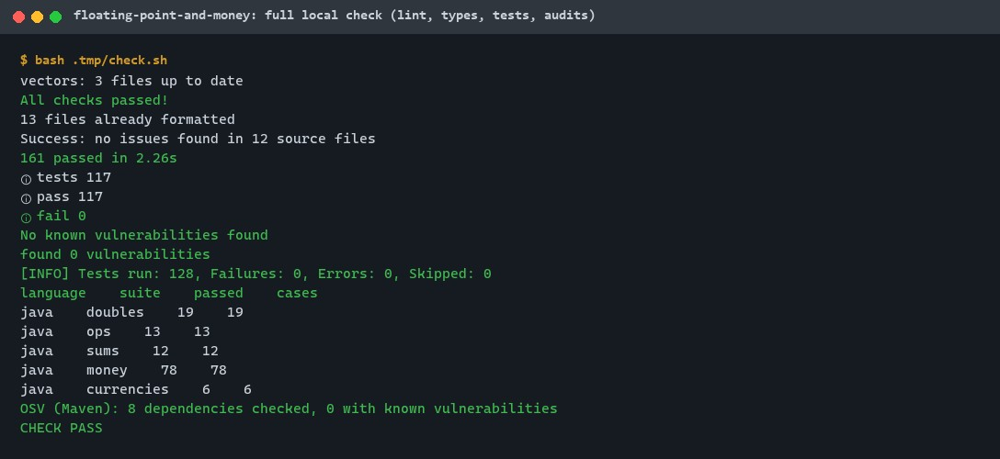
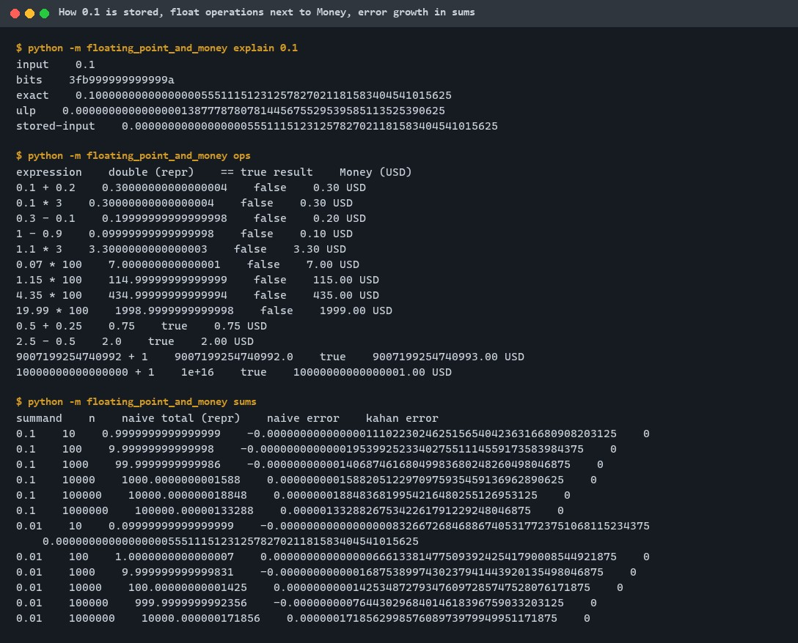
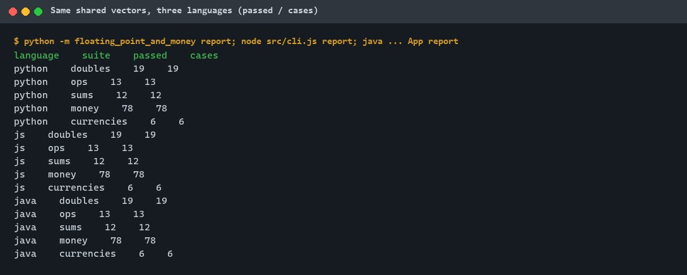
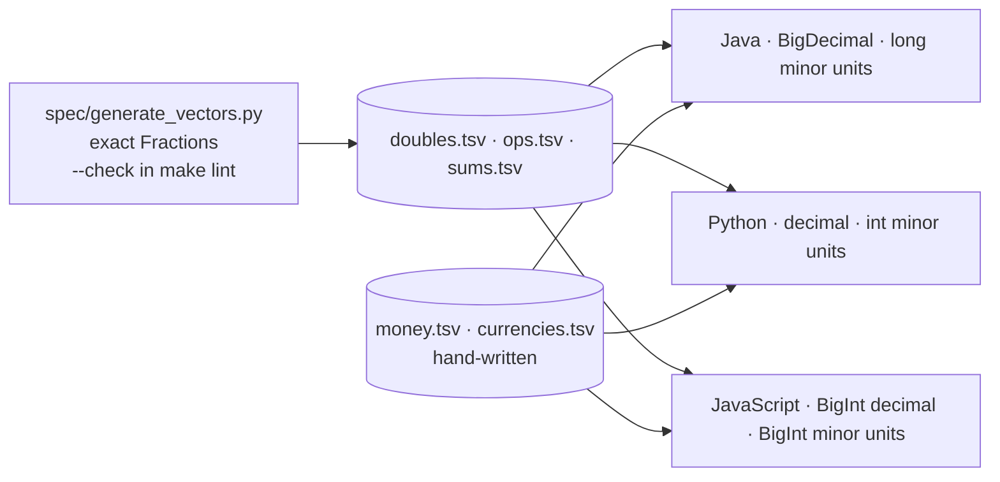
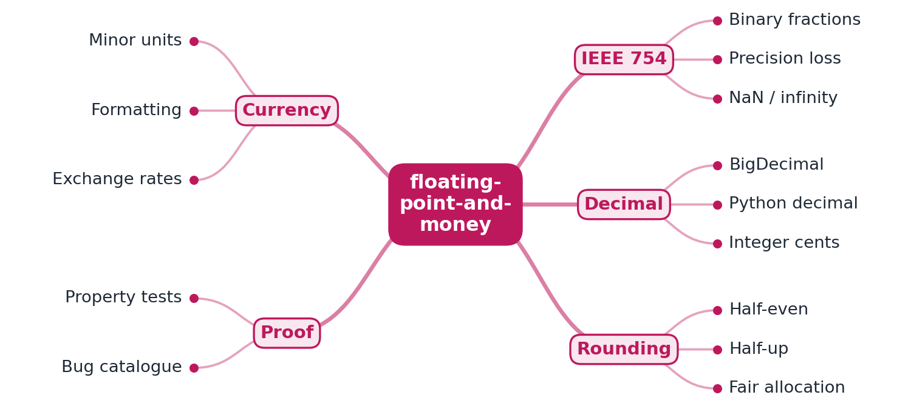
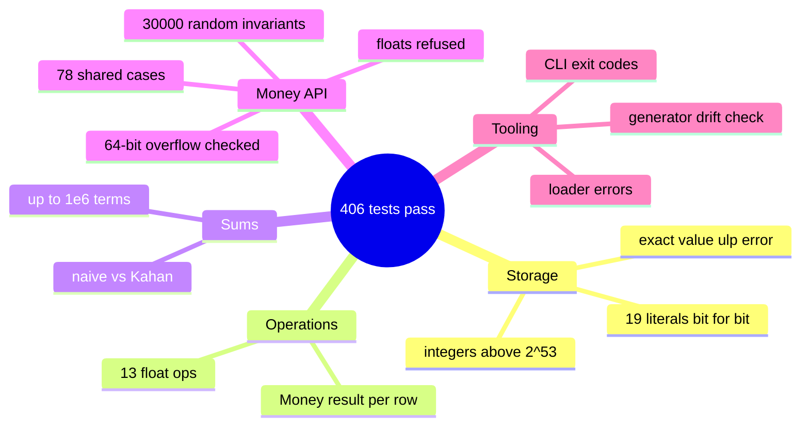

# floating-point-and-money

[](https://github.com/EquinoxWN/floating-point-and-money/actions/workflows/ci.yml)


> Why 0.1 + 0.2 isn't 0.3 and how that quietly loses money: number representation, rounding and currency handled correctly in Java, Python and JS.

Part of my **CS Foundations** list · Java · Python · JS · core project

## Proof it works

One set of shared vectors, generated with exact rational arithmetic, runs in all three languages:
128 Java, 161 Python and 117 JavaScript tests pass, every language reproduces every bit pattern,
and the dependency audits are clean.



The experiments: how 0.1 is stored, float operations next to the Money API, and error growth in sums.



The same vectors scored in each language (passed / cases):



## Architecture

**What M1 runs today:**



**Full roadmap (M1 to M3):**



## How it works

_Steps 1 and 2 are built and tested (M1); the rest is on the [roadmap](#roadmap)._

1. Experiments show exactly how binary floating point stores 0.1, where precision is lost and how errors grow in sums.
2. Each language implements money with decimal types or integer minor units, never floats, behind the same small API.
3. Rounding modes (half-even, half-up, truncation) are compared on real invoices to show where cents appear or vanish.
4. Splitting 100 three ways allocates the leftover cent deterministically, so totals always balance.
5. Currencies use ISO 4217 minor units (the yen has none, the dinar has three) and locale-aware formatting.
6. Property tests assert invariants such as 'parts always sum to the total' across millions of random amounts.

In M1:

- `spec/generate_vectors.py` computes, with `fractions.Fraction`, how 19 decimal literals are
  stored as doubles (bits, exact value, ulp, error), the result of 13 float operations, and the
  totals of adding 0.1 or 0.01 up to 1,000,000 times, naively and with Kahan summation.
  `--check` fails when the committed files drift.
- Each language recomputes all of it with its own tools (Java `BigDecimal`, Python `decimal` with
  `Inexact` trapped, JavaScript a small `BigInt` decimal) and must match every value.
- `Money` holds an integer count of minor units and an ISO 4217 code, in the same signed 64-bit
  range everywhere ([ADR 0002](docs/adr/0002-integer-minor-units.md)). API: `parse`, `ofMinor`
  (`of_minor`), `total`, `plus`, `minus`, `times(integer)`, `negate`, `compare`, `amount`,
  `toString` (`12.34 USD`). Errors have a kind: `parse`, `currency`, `overflow`, `mismatch`.
- `parse` refuses floats, exponents, separators, non-ASCII digits and more fraction digits than the
  currency has, instead of rounding ([ADR 0003](docs/adr/0003-refuse-instead-of-round.md)).
  M1 knows USD, EUR, GBP (2 digits), JPY (0) and KWD (3).

## Who it helps

- **Who:** Engineers who handle prices, invoices or payments in Java, Python or JavaScript, and reviewers who need to explain why amounts must not be floats.
- **The problem:** `19.99 * 100` is 1998.9999999999998 as a double, so a cast to whole cents loses one; `0.1 + 0.2 == 0.3` is false; the printed value hides the error.
- **How to use it:** Run `explain` on any literal to see its exact stored value, `ops` and `sums` to show a team where floats go wrong, and use the `Money` class (or its rules: integer minor units, refuse rather than round, checked overflow) in your own code. The shared `money.tsv` cases can test another money implementation.

## Tech stack

| Area | In M1 | Planned |
|---|---|---|
| Code | Java 21 (`BigDecimal`, `Math.*Exact`), Python 3.11+ (`decimal`, `fractions`), JavaScript on Node.js 24 (`BigInt`, `DataView`); no runtime dependencies | Rounding modes and allocation (M2), ISO 4217 table and `Intl.NumberFormat` formatting (M3) |
| Tests | Shared vectors; JUnit 5, pytest, `node:test`; seeded random invariants | jqwik, Hypothesis, fast-check property tests over millions of amounts (M3) |
| Quality | `javac -Xlint:all -Werror`, ruff, `mypy --strict`, `node --check`; pip-audit, npm audit, OSV | - |

| Path | What it is |
|---|---|
| `spec/generate_vectors.py` | Builds the experiment vectors from exact rationals; `--check` for drift |
| `spec/vectors/` | `doubles.tsv`, `ops.tsv`, `sums.tsv` (generated), `money.tsv`, `currencies.tsv` (hand-written) |
| `java/src/main/java/portfolio/floatingpointandmoney/` | `Floats`, `Money`, `MoneyException`, `Vectors`, `Conformance`, `App` (CLI) |
| `python/src/floating_point_and_money/` | `floats`, `money`, `vectors`, `conformance`, `cli` |
| `js/src/` | `floats.js`, `money.js`, `vectors.js`, `conformance.js`, `cli.js` |

## Run it

Needs JDK 21+ with Maven, Python 3.11+ and Node.js 24+. Nothing is downloaded at run time.

```bash
make setup         # install the Python package and dev tools
make lint          # vectors up to date, javac -Werror, ruff, mypy, node --check
make test          # Java, Python and JavaScript test suites
make report        # passed / cases for each language on the shared vectors
make experiments   # explain 0.1, the ops table and the sums table (Python)
make audit         # pip-audit, npm audit, OSV-Scanner on the Maven SBOM
```

Or one language at a time:

```bash
cd java && mvn verify && java -cp target/classes portfolio.floatingpointandmoney.App explain 19.99
cd python && pytest && python -m floating_point_and_money ops
cd js && npm test && node src/cli.js sums
```

```python
from floating_point_and_money import Money
Money.total([Money.parse("0.10", "USD")] * 10, "USD")   # 1.00 USD; ten 0.1 floats give 0.9999999999999999
```

Java reads the vectors from the `fpm.vectors` system property (set by `pom.xml` for tests), else
`../spec/vectors`; every CLI also accepts `--vectors DIR` as its first argument.

## Tests and results

Latest local run (full detail in [docs/results/m1.md](docs/results/m1.md)):

| Suite | Java | Python | JavaScript |
|---|---|---|---|
| doubles: 19 literals (bits, exact value, ulp, error) | 19 / 19 | 19 / 19 | 19 / 19 |
| ops: 13 float operations and their Money results | 13 / 13 | 13 / 13 | 13 / 13 |
| sums: 12 naive and Kahan runs, up to 10^6 terms | 12 / 12 | 12 / 12 | 12 / 12 |
| money: 78 shared API cases | 78 / 78 | 78 / 78 | 78 / 78 |
| Tests passed | 128 | 161 | 117 |

| Test file | Tests | What it proves |
|---|---|---|
| `java/.../FloatsTest.java` | 28 | Storage of 0.1 and of integers above 2^53; doubles, ops, sums vectors; invalid literals, non-finite values, bad counts |
| `java/.../MoneyTest.java` | 87 | 78 shared Money cases; every error kind covered; no method takes a `double`, `float` or `BigDecimal`; 10,000 seeded random invariants |
| `java/.../HarnessAndCliTest.java` | 13 | Loader errors; corrupted vectors are counted; CLI output and exit codes |
| `python/tests/test_floats.py` | 35 | Experiment values and vectors; invalid input |
| `python/tests/test_money.py` | 96 | Shared cases; floats and bools refused; operators; 10,000 seeded random invariants |
| `python/tests/test_harness.py` | 12 | Loader errors; corrupted vectors and broken `kahan_sum` / `ulp` are caught |
| `python/tests/test_cli_and_generator.py` | 18 | CLI; generator drift check, exact conversion, atomic writes |
| `js/test/floats.test.js` | 30 | Experiment values, subnormals, vectors, loader errors, CLI |
| `js/test/money.test.js` | 87 | Shared cases; implicit coercion refused; frozen instances; 10,000 seeded random invariants |

Headline numbers: `0.1` is stored as 0.1000000000000000055511151231257827021181583404541015625;
9 of 13 float operations miss the double of the true result (`19.99 * 100` = 1998.9999999999998);
adding 0.1 a million times drifts by 1.33e-6, and Kahan summation removes that drift for these
inputs. The Money API gives the exact result in every row. CI has not run yet (not pushed).
Quality check against the 10 rules, with 14 hand mutations (all killed):
[docs/quality/2026-11-01.md](docs/quality/2026-11-01.md).

### Test map



## Roadmap

**M1** (≈15 h)
- [x] Write `docs/rfc/0001-design.md`: problem, goals, non-goals, chosen design
- [x] Experiments show exactly how binary floating point stores 0.1, where precision is lost and how errors grow in sums.
- [x] Each language implements money with decimal types or integer minor units, never floats, behind the same small API.

**M2** (≈20 h)
- [ ] Rounding modes (half-even, half-up, truncation) are compared on real invoices to show where cents appear or vanish.
- [ ] Splitting 100 three ways allocates the leftover cent deterministically, so totals always balance.

**M3** (≈25 h)
- [ ] Currencies use ISO 4217 minor units (the yen has none, the dinar has three) and locale-aware formatting.
- [ ] Property tests assert invariants such as 'parts always sum to the total' across millions of random amounts.
- [ ] Publish the proof below with real numbers

## Proof

What this repo must show before it counts as done:

- A catalogue of real money bugs reproduced in each language, each fixed and guarded by a property test.

| Result | Value |
|---|---|
| M3 proof above | Not complete yet (the bug catalogue and property tests are M3). Current M1 numbers: see [Tests and results](#tests-and-results). |

## Known limitations

- M1 supports five currencies (USD, EUR, GBP, JPY, KWD); the full ISO 4217 list is M3.
- Multiplication is by integers only; rates (tax, FX) need a rounding mode and come with M2.
- Amounts are limited to ±(2^63-1) minor units in every language, so Python and JS refuse values their own integers could hold.
- `parse` refuses `12.340` USD (trailing zeros beyond the scale) and any locale format.
- The random invariants run 2,000 pairs per currency per language, not the millions planned for M3.

## Why it matters

- **Interview angle:** 'Design the amount model for invoices or payments' and numeric-precision follow-ups.
- **Upstream I'd like to contribute to:** JavaMoney Moneta (JSR 354 reference implementation): docs or tests.

## Design docs

- [RFC 0001: design](docs/rfc/0001-design.md)
- [ADR 0001: record architecture decisions](docs/adr/0001-record-architecture-decisions.md)
- [ADR 0002: store money as integer minor units with a shared 64-bit range](docs/adr/0002-integer-minor-units.md)
- [ADR 0003: parsing refuses extra fraction digits instead of rounding](docs/adr/0003-refuse-instead-of-round.md)
- [M1 results](docs/results/m1.md)
- [Quality check against the 10 rules (2026-11-01)](docs/quality/2026-11-01.md)

## Scope

This is a learning and portfolio system, not a hosted production service. Everything runs locally
and nothing is downloaded at run time.

## Security and contributing

- Every GitHub Action is pinned to a commit SHA; workflows run read-only, without persisted credentials.
- Dependabot update pull requests are paused (`open-pull-requests-limit: 0`) so the repository keeps a single `main` branch; dependencies are updated by hand and checked by the CI audit.
- All input (literals, amounts, currency codes, vector files) is validated with size limits.
- Report vulnerabilities privately: see [SECURITY.md](SECURITY.md). To contribute, see [CONTRIBUTING.md](CONTRIBUTING.md).

## License

MIT, see [LICENSE](LICENSE).
